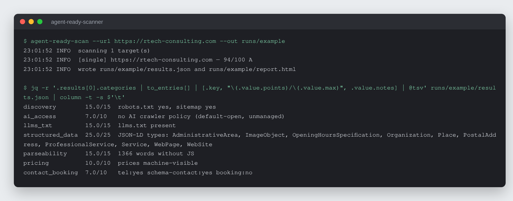
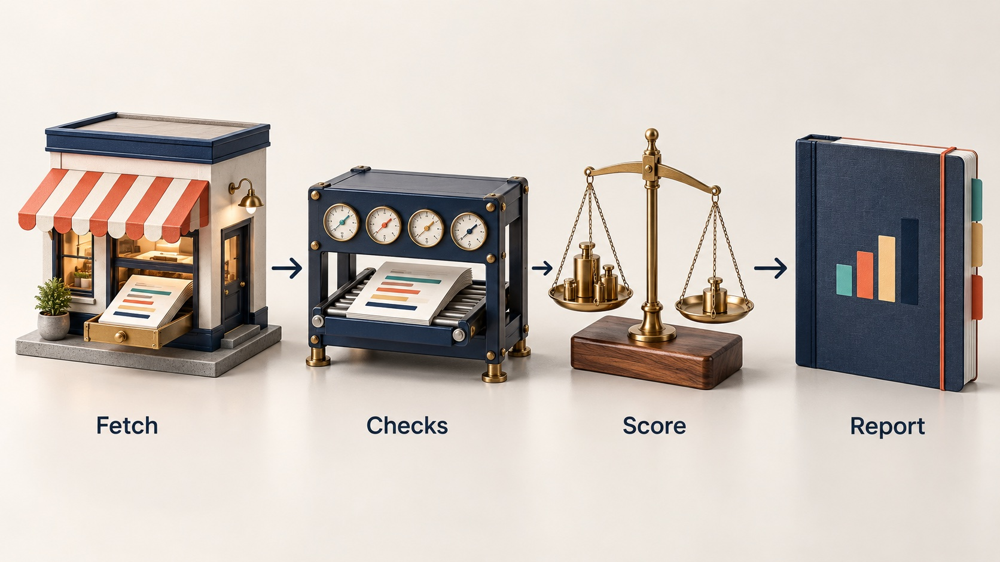

# Agent-Ready Scanner

Score any business website 0-100 on what an AI agent can actually read, from
raw HTTP, and get a plain list of what is missing.


## What it is

A command-line scanner that answers one question per site: can an AI agent
read, understand and act on this business's website? It fetches each page the
way an AI crawler does, without running JavaScript, and scores seven
categories with a fixed weight table. Each site gets a 0-100 score, an A-F
grade and a per-category breakdown, written to `results.json` and to one
self-contained `report.html` that can be handed to the site owner.



*A real run against rtech-consulting.com on 2026-10-27. The loguru timestamp
prefix is shortened; nothing else is edited.*

## Why it exists

More customers now reach a business through an AI assistant instead of a page
of search results. An assistant can only recommend, quote or book what it can
read. Most small-business sites were built for a person with a browser, and
the person who maintains the site has no quick way to see what an AI agent
cannot see there. The scanner gives that person a specific, ordered list of
gaps (no `llms.txt`, no structured business data, prices only in images, no
booking link) so they can fix them. It never changes the site.

## How it works



The CLI (`agent-ready-scan`) takes one `--url` or a CSV of `vertical,name,url`
rows. For each site, `services/fetch.py` does the raw HTTP work through one
`httpx` client: the page, its visible text, JSON-LD blocks and the
robots.txt AI-crawler policy. `services/checks.py` collects signals from the
page and its side files (robots.txt, sitemap, `llms.txt`, `/.well-known/`
probes) and scores them. `services/report.py` renders the batch, grouped by
vertical, into JSON and one offline HTML report. Results are Pydantic models
(`models/site_result.py`).

## Features

| Category | Points | Signals |
|----------|-------:|---------|
| discovery | 15 | robots.txt, sitemap |
| ai_access | 10 | AI-crawler policy in robots.txt (GPTBot, ClaudeBot, PerplexityBot, ...) |
| llms_txt | 15 | llms.txt, llms-full.txt |
| structured_data | 25 | JSON-LD: business identity, offers/FAQ, schema contact |
| parseability | 15 | no-JS visible word count, text ratio, title and meta description |
| pricing | 10 | machine-visible prices (page text, priceRange/offers schema, pricing page) |
| contact_booking | 10 | `tel:` link, schema contact, booking link |

- Grades: A >= 85, B >= 70, C >= 55, D >= 40, F < 40.
- Robots.txt groups follow standard precedence: a specific `User-agent` group
  wins over `*`, and a wildcard `Disallow: /` counts as blocking every AI
  crawler that has no group of its own.
- A JSON-LD `offers` object only counts as pricing when it carries an actual
  price.
- Emerging signals are recorded but not scored: `/.well-known/mcp.json`,
  `/.well-known/ai-plugin.json`, HTTP 402 responses.
- It never scores a site it could not read. Connection failures, timeouts,
  error statuses and non-HTML responses are reported as
  `NOT SCANNED - <reason>`, never as a zero or an F. A zero means the site was
  readable and has none of the signals. See `OPERATIONS-MANUAL.md` section 5.

Stack: Python 3.14, `httpx`, BeautifulSoup, Pydantic v2, loguru. Packaged as a
`uv` app (`pyproject.toml`, `uv.lock`) with a generated `requirements.txt`.

## Run it locally (for review)

```bash
uv sync --frozen
uv run agent-ready-scan --url https://example.com --out runs/example
uv run agent-ready-scan targets/example.csv --out runs/batch
uv run pytest -q
```

Without uv: `pip install -r requirements.txt` into a Python 3.14 virtual
environment, then `python -m agent_ready_scanner --url ...`. The tests are
offline: they drive the scanner through `httpx.MockTransport`.

`runs/self-after-deploy/` holds a sample `report.html` and `results.json` from
an earlier scan of rtech-consulting.com. A score is a snapshot of a site on its
scan date, not a standing fact.

More docs: `START-HERE.md`, `installer.md`, `OPERATIONS-MANUAL.md`,
`tiers/basic/README.md`, `CHANGELOG.md`.

Licence: free for personal and non-commercial use with credit; commercial use
needs a licence. See `LICENSE` (PolyForm Noncommercial 1.0.0) or write to
rico@rtech-consulting.com.

## How it was built

Built in August 2026 as a proof of concept, hardened after a second-model code
review caught two scoring bugs, and promoted to a packaged kit in September.
The dated story, including what went wrong, is in
[docs/BUILD-STORY.md](docs/BUILD-STORY.md).

## Project status

Active, version 0.1.0. Used as an operator tool: an operator runs the scan and
the site owner receives the report. 13 offline tests pass; ruff and mypy
strict are clean.

## Author

Rico Rojas, https://rico-rojas.com
