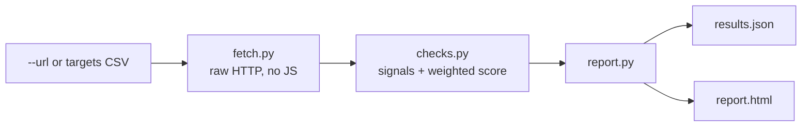

# agent-ready-scanner

Deterministic agent-readiness scoring for business websites.

> Portfolio piece. Source shown for review only; not licensed for use. See LICENSE.

## What it does

It answers one question per site, from raw HTTP only: **can an AI agent read,
understand, and act on this business's website?** No JavaScript is executed,
so the scanner sees exactly what an AI crawler or agent sees. Each site gets a
0-100 score, an A-F grade, and a per-category breakdown, written to
`results.json` and a self-contained branded `report.html`.

## The problem

More customers now reach a business through an AI assistant instead of a
search results page. An assistant can only recommend, quote or book what it can
read. Most small-business sites were built for people with a browser, and the
person who maintains the site has no quick way to find out what an AI agent
cannot see there. This tool hands that person a specific, ordered list of what
is missing, so they can act on it. It does not touch the site.

## How it works

The CLI takes one `--url` or a CSV of `vertical,name,url` rows. For each site,
`services/fetch.py` does the raw HTTP work (page fetch, visible text, JSON-LD
extraction, robots.txt AI-crawler policy) through one `httpx` client.
`services/checks.py` collects signals from the page and its side files
(robots.txt, sitemap, llms.txt, `/.well-known/` probes) and scores them with a
fixed weight table. `services/report.py` renders the batch, grouped by
vertical, into JSON and one offline HTML report. Results are Pydantic models
(`models/site_result.py`).



## Features

| Category | Points | Signals |
|----------|-------:|---------|
| discovery | 15 | robots.txt, sitemap |
| ai_access | 10 | AI-crawler policy in robots.txt (GPTBot, ClaudeBot, PerplexityBot, ...) |
| llms_txt | 15 | llms.txt, llms-full.txt |
| structured_data | 25 | JSON-LD: business identity, offers/FAQ, schema contact |
| parseability | 15 | no-JS visible word count, text ratio, title + meta description |
| pricing | 10 | machine-visible prices (page text, priceRange/offers schema, pricing page) |
| contact_booking | 10 | tel: link, schema contact, booking link |

- Grades: A >= 85, B >= 70, C >= 55, D >= 40, F < 40.
- Emerging signals are recorded but not scored: `/.well-known/mcp.json`,
  `/.well-known/ai-plugin.json`, HTTP 402 responses.
- **It never scores a site it could not read.** If the root document does not
  return a 2xx HTML response (connection refused, DNS failure, timeout,
  non-HTML content type, error status), the site is reported as
  `NOT SCANNED - <reason>`, never as a zero or an F. A zero means the site is
  readable and has none of the signals. Unreachable means unknown. Full
  statement in `OPERATIONS-MANUAL.md` section 5.

## Stack

Python 3.14, `httpx`, BeautifulSoup, Pydantic v2, loguru. Packaged as a `uv`
app (`pyproject.toml`, `uv.lock`) with a generated `requirements.txt`. Tests
use pytest with `httpx.MockTransport`, fully offline. Lint and types: ruff and
mypy strict.

## Status

Active, version 0.1.0. Built as an internal operator tool: an rTech operator
runs the scan and the client receives the report. 13 offline tests pass.

## Running it locally (for reviewers)

```bash
uv sync
uv run agent-ready-scan --url https://example.com --out runs/example
uv run agent-ready-scan targets/example.csv --out runs/batch
uv run pytest
```

Without uv: `pip install -r requirements.txt`, then
`python -m agent_ready_scanner ...`. `runs/self-after-deploy/` holds a sample
report from a past scan of rtech-consulting.com.

Other docs: `START-HERE.md`, `installer.md`, `OPERATIONS-MANUAL.md`,
`tiers/basic/README.md`, `CHANGELOG.md`.

## Screenshots

None in the repo. Open `runs/self-after-deploy/report.html` in a browser to
see the report format.

## Author

Rico Rojas, rico@rtech-consulting.com, https://rico-rojas.com
